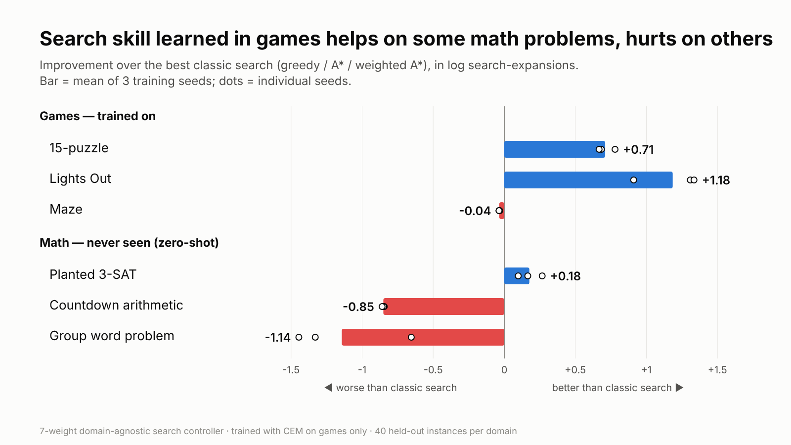

# Does search skill learned in games transfer to math?

A small, fully reproducible experiment in two rounds. Each round makes a
pre-registered prediction, and neither survived.

- **V1** (this page): does search skill learned in games transfer to math?
- **[V2](v2/README.md)**: can a controller that reads its own search landscape turn
  diverse procedural games into transfer? It passed its pre-registered test, then
  **failed a pre-registered replication**.



**TL;DR**: A 7-parameter, domain-agnostic search controller trained only on
puzzle games learns real skill in those games. Applied zero-shot to math search
problems, it beats classic search on planted 3-SAT and loses on Countdown
arithmetic and a group word problem. Cheap "landscape fingerprints" of the domains
correlated with where transfer worked. The one prediction I committed to git
before running, based on that correlation, failed. Transfer is real but
selective, and nothing I tried predicts it.

---

## Why

There are recurring claims and rumors that frontier labs get large reasoning
gains by training models with RL on games, simulators and long interactive
tasks, and that those skills then *transfer* to fields like research mathematics.
I can't verify any of those claims, and this repo says nothing about what any lab
actually does. It asks a narrower question that a laptop can test:

> If something transfers from games to math, **what** is it? And can we tell
> in advance **where** it will transfer?

## The idea: transfer lives in *search control*

Hypothesis: the transferable part of interactive training is not domain
knowledge but **control of search**: when to trust your heuristic, when to
explore, when to abandon a line, and how to behave when stuck.

To test that in isolation, I built a controller that *cannot* learn domain
knowledge. It never sees states, moves, or the units of the heuristic. It sees
only dimensionless signals about the search itself and uses them to order a
best-first frontier (`priority = w · φ(node)`, lower is expanded first):

| # | feature | meaning |
|---|---|---|
| 0 | `h_rel` | h / h(start): how close the heuristic says we are |
| 1 | `gain` | (h_parent − h) / h(start): did this step make local progress? |
| 2 | `depth_rel` | g / (1 + depth of best node so far) |
| 3 | `crowding` | how many generated nodes share this h-level (plateau pressure) |
| 4 | `sib_rank` | rank among siblings, in [0, 1] |
| 5 | `stall` | expansions since the last new best h, divided by budget (switches on when stuck) |
| 6 | `stall × depth` | when stuck, prefer shallow (restart-like) or deep (commit) nodes |

Because every input is domain-free, **the same 7 weights run unchanged in any
domain**, which makes transfer cleanly measurable.

## Setup

| | domains | heuristic given to the search |
|---|---|---|
| **Training: games** | 15-puzzle · 5×5 Lights Out · deceptive 45×45 mazes | Manhattan · lit cells / 5 · Manhattan |
| **Test: math, never seen** | Countdown (reach a target with + − × ÷) · word problem in S₁₃ with TopSpin generators · planted random 3-SAT (90 vars, ratio 4.3) | log distance to target · cyclic breakpoints · unsatisfied clauses |

- **Training**: cross-entropy method (population 20, 5 elite, 14 iterations), 16
  training instances per domain, 3 independent seeds.
- **Evaluation**: 40 held-out instances per domain, a budget of 3,000 node
  expansions. Cost = mean log(1 + expansions), with failure costing
  log(1 + budget) + 1. Lower is better.
- **Baselines**: greedy best-first, A\*, weighted A\* (w = 3), 5 random
  controllers, and an **oracle**: the same controller trained directly on each math
  domain (an upper reference).

## Results

### 1. The controller learns real skill in the games

In distribution, it beats every classic baseline. Lights Out cost goes from 5.95
to about 4.8, and the 15-puzzle solve rate from 80% to about 99%. Random
controllers are far worse everywhere, so the gain comes from learning.

### 2. Zero-shot transfer to math is selective

| math domain | best classic | games-trained (mean of 3 seeds) | oracle |
|---|---|---|---|
| Planted 3-SAT | 7.92 | **7.74**, better than all classic baselines (closes 30% of the gap to the oracle) | 7.33 |
| Countdown | 2.90 (A\*) | 3.75, worse | 2.93 |
| Group word problem | 5.91 (greedy) | 7.05, much worse | 6.00 |

### 3. Landscape fingerprints correlate with transfer…

Each domain gets a fingerprint from plain greedy search, with no learning involved:
the fraction of moves that improve, tie or worsen h, the step size, and the
branching factor. Training one controller per single game gave a
game × math transfer matrix. Fingerprint distance correlated with transfer:
**Spearman −0.80** over 9 pairs.

The group word problem stood out. **58%** of its moves are plateau moves (h is
unchanged), against **≤ 6%** in every game.

### 4. …but the pre-registered prediction built on that failed

**Prediction**: adding a plateau-heavy game (Tower of Hanoi) to training will
improve transfer to the group word problem. It was committed in
`plateau_test.py` (commit `17db430`, 16:28 UTC) before the run, and the results
were committed afterwards in `ac8c35a`.

| training set | Countdown | group word | 3-SAT |
|---|---|---|---|
| games only | −0.13 | −1.14 | +0.18 |
| games + Hanoi (8 disks) | +0.01 | **−1.24** | +0.11 |
| *post-hoc:* games + Hanoi (6 disks, fully learnable) | +0.06 | **−1.35** | +0.10 |

*(T = greedy cost − controller cost; positive means it helped.)* **Falsified**,
including the post-hoc rerun with an easier Hanoi. The fingerprint correlation was
most likely driven by group word being an outlier.

### 5. Three more simple explanations also fail (exploratory)

- **Weight similarity**: the games-trained controllers point *closest* to the
  group-word oracle (cosine 0.94) and still transfer worst there.
- **Sensitivity**: rotating the controller by 10–30° doesn't punish group word
  unusually hard.
- **One bad habit**: removing one feature at a time doesn't remove the harm.
  Removing sibling-rank recovers the most (−1.14 → −0.68).

Full tables: [RESULTS.md](RESULTS.md).

## What I take from it

1. **Interactive training produced domain-free search skill**, and that skill
   **did transfer** to a structurally different math problem (SAT).
2. **It is not a general reasoning upgrade.** The same skill hurt on two other
   math problems.
3. **"Where will it transfer?" is the hard question.** Several cheap explanations
   failed, including one I committed to in advance. A claim of broad transfer from
   games should come with a source × target transfer matrix that includes the
   negative cases. Without one, it is an anecdote.

## Limitations

This is a toy: a 7-parameter linear controller, three games, three math
domains, and 40 test instances per domain. CEM budgets are small. The correlation
has n = 9. Hanoi was chosen *after* seeing the fingerprints, deliberately, to test
the fingerprint idea. Items marked post-hoc or exploratory were run after the
prediction failed and should be read that way. Larger models, learned
(non-linear) controllers and richer environments could behave quite differently.

## Reproduce

Pure Python 3 with the standard library only. About 30 minutes on 4 cores.

```bash
python3 experiment.py        # main run -> results.json (~22 min)
python3 report.py            # -> RESULTS.md main tables (overwrites RESULTS.md)
python3 transfer_matrix.py   # single-game transfer + fingerprints (appends)
python3 plateau_test.py      # pre-registered Hanoi test (appends)
python3 plateau_posthoc.py   # post-hoc 6-disk Hanoi (appends)
python3 sensitivity.py       # post-hoc perturbation sensitivity (appends)
python3 ablation.py          # post-hoc feature ablation (appends)
python3 figures/make_chart.py  # chart (PNG rendering needs Node + Playwright)
```

| file | contents |
|---|---|
| `domains.py` | all 7 domains (games, math, Hanoi) behind one tiny interface |
| `search.py` | controller-driven best-first search + classic baselines |
| `experiment.py` | CEM training + held-out evaluation |
| `transfer_matrix.py` | single-game transfer matrix + landscape fingerprints |
| `plateau_test.py`, `plateau_posthoc.py` | pre-registered prediction + post-hoc variant |
| `sensitivity.py`, `ablation.py` | post-hoc diagnostics |
| `results.json`, `transfer_matrix.json`, `plateau_test.json` | raw results (per-instance expansions included) |
| `RESULTS.md` | every table |

## V2 follow-up

[**V2**](v2/README.md) tested the most promising explanation for V1's
mixed results. The idea: negative transfer is interference between
regime-specific skills, and a controller that identifies its regime in-context
could fix it when trained on many procedurally generated games. The pre-registered
test passed on 3 seeds, but a pre-registered replication on 6 fresh seeds found
nothing (p = 0.52). Across all 9 seeds, procedural games transferred *worse* than
V1's three hand-made games.

## Next ideas

- Non-linear controllers (a small MLP over the same features) and many more games.
- A large source × target transfer matrix, to find *what* predicts transfer.
- Training on a distribution of procedurally generated games instead of three
  hand-picked ones.
- Replacing the toy math domains with real proof search (e.g. Lean tactic search).
