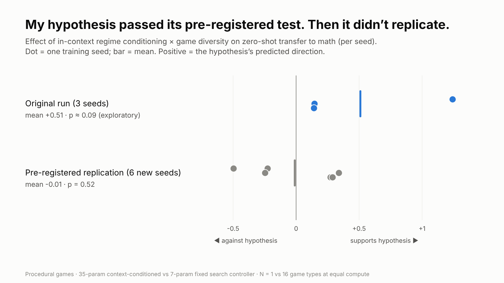

# V2: Can a search controller that reads its own landscape turn game diversity into transfer?



**TL;DR**: V1 showed that search skill learned in games transfers to some math
problems and hurts on others. V2 tested a mechanism and a fix. The mechanism:
negative transfer is *interference* between regime-specific skills. The fix: a
controller that identifies its regime **in-context**, from its own running search
statistics, should be able to turn diverse procedural games into positive transfer.

The pre-registered test **passed** (3 seeds). A pre-registered replication on 6
fresh seeds **failed** (p = 0.52). The original "effect" was one lucky seed. Across
all 9 seeds, training on procedurally generated games transferred *worse* than
V1's three hand-made games, whatever the controller.

---

## The idea

The V1 oracle controllers (one trained directly on each math problem) want
**opposite signs** on the same features. The `gain` weight is −1.51 for Countdown
and positive for the other two. Group word wants `crowding` and `sib_rank`
negative; the others want them positive. A single fixed controller can only learn
a compromise, which would explain why adding more games (Hanoi in V1) hurt.

**Regime-conditioned search control**: let the controller's weights depend on a
running, in-context reading of the landscape:

```
w_eff = W0 + W1 · (c − c_mid)        c = [plateau rate, improvement rate, log branching, mean step]
```

That's 35 parameters instead of 7. Trained on many *procedurally generated*
games, it should learn a map from regime to strategy, rather than an average
strategy that's wrong everywhere.

**Prediction:** more game diversity helps the conditioned controller but not a
fixed one, at equal compute.

## Design

- **Procedural games** (`procgen.py`), with no human design:
  - *XOR-mask games*: bitstrings with random toggle masks and quantized weighted
    popcount (plateaus); dense masks make them deceptive.
  - *Lattice games*: random move vectors in a d-dimensional box, hashed obstacles,
    and thick barrier slabs whose gap sits far from the line of sight. Starts are
    chosen by BFS from the farthest 30% of reachable states.
  - Types are kept only if they're neither trivial nor hopeless for greedy search.
- **Diversity at equal compute:** N ∈ {1, 2, 4, 8, 16} game types sharing the same
  24 training instances, CEM 24 × 16, budget 3,000 expansions.
- **Three controllers:**
  - `fixed`: the V1 controller, 7 parameters.
  - `online`: context-conditioned, 35 parameters.
  - `random`: 35 parameters, but the context is random per instance and never
    measured. This is the capacity-matched control.
- **Evaluation:** zero-shot on the V1 math test sets (Countdown, group word,
  planted 3-SAT) and the V1 hand-made games.
- **Everything pre-registered:** [PREREGISTRATION.md](PREREGISTRATION.md),
  including an addendum for a determinism bug that was found and fixed before any
  analysis.

## Results

### Original grid: 3 seeds, pre-registered ([RESULTS_V2.md](RESULTS_V2.md))

| | verdict |
|---|---|
| P1 more diversity → better transfer for `online` (Spearman +0.30) | holds |
| P2 `online` beats `fixed` at N=16, and the gap grows from N=1 | holds |
| P3 `online` beats the random-context control at N=16 | holds |
| P4 (stretch) `online` beats greedy on group word | fails |

By the pre-registered rule, the headline was **supported**. But the effects were
the size of the seed noise (seed SD ≈ 0.19; exploratory permutation p ≈ 0.09 for
P2), so I registered a confirmatory replication before claiming anything.

### Confirmatory replication: 6 fresh seeds, pre-registered ([RESULTS_REPLICATION.md](RESULTS_REPLICATION.md))

| test | mean | one-sided p | verdict |
|---|---|---|---|
| R1 `online`(16) − `fixed`(16) | −0.02 | 0.63 | fails |
| R2 conditioning × diversity interaction | −0.01 | 0.52 | fails |
| R3 `online`(16) − `random`(16) | +0.13 | 0.17 | fails |

**Not replicated.** The original interaction was +1.24 on seed 0 and about +0.15 on
the other two seeds; on the new seeds it scatters around zero.

### What holds across all 9 seeds

Mean transfer to math (T = greedy cost − controller cost):

| | N = 1 | N = 16 |
|---|---|---|
| fixed | −0.99 | −1.02 |
| online | −1.04 | −0.91 |
| random | −1.10 | −1.07 |
| *V1, 3 hand-made games, fixed* | *−0.37* | |

- **Procedural games transfer worse than three hand-made games.** This holds for
  every controller and every level of diversity. Sixteen random synthetic game
  types, at equal compute, are a worse teacher than a 15-puzzle, Lights Out and a
  maze.
- **More diversity barely matters**, for any controller.
- **In-context conditioning gave no reliable benefit** at this scale.

## What I take from it

1. **"Train on lots of synthetic games and it transfers" is not automatic.**
   Here, synthetic diversity made things worse than a few well-chosen games. *Which*
   environments you train on mattered more than how many.
2. **The interference story may still be right, but this fix didn't work.** A
   linear context modulation learned by a small CEM may be too weak, the context
   statistics too noisy early in a search, or the procedural regimes too unlike the
   math ones.
3. **A pre-registered "success" on 3 seeds was noise.** Without the replication,
   this would have read as a positive result. That's the standard to apply to
   rumors of dramatic transfer, too: one striking result is a seed, not a finding.

## Limitations

These are small models (7 or 35 parameters), a small CEM budget, two procedural
families, three math domains and 40 test instances each. A null result at this
scale doesn't rule out the idea for larger learners (e.g. neural controllers with
proper RL), richer context or many more environments.

## Reproduce

```bash
cd v2
PYTHONHASHSEED=0 python3 experiment_v2.py      # original grid -> results_v2.json (~1.5-2.5 h, 4 cores)
python3 analyze_v2.py                          # -> RESULTS_V2.md
NS=1,16 SEEDS=3,4,5,6,7,8 OUT=replication_v2.json PYTHONHASHSEED=0 python3 experiment_v2.py
python3 analyze_replication.py                 # -> RESULTS_REPLICATION.md
python3 figures/make_chart_v2.py
```

Runs save after each training run and can resume. `results_v2_ABORTED_unanalyzed.json`
is the first launch, which had the determinism bug; it was never analyzed.
